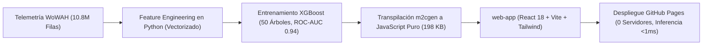

# ⚔️ World of Warcraft Churn Prediction

> **Pipeline de Analítica Predictiva & Motor de Retención Serverless Machine Learning**  
> Modelo XGBoost entrenado sobre más de **10.8 millones de registros de telemetría** del dataset *World of Warcraft Avatar History (WoWAH 2008)* y compilado a JavaScript puro para inferencia instantánea en el navegador (*Zero-Backend, Zero-Latency, Zero-Cost*).

[](https://github.com)
[](https://xgboost.readthedocs.io/)
[](https://scikit-learn.org/)
[-blue?style=flat&logo=javascript)](https://github.com/BayesWitnesses/m2cgen)
[](https://react.dev/)

---

## 🧭 1. Resumen Ejecutivo & Problema de Negocio

En videojuegos multijugador masivos (MMORPGs) y servicios por suscripción mensual (SaaS), la **deserción de usuarios (Churn)** representa el principal detractor de ingresos recurrentes (ARR/MRR). La adquisición de un nuevo jugador es hasta **5 veces más costosa** que la retención de un usuario existente.

### Objetivo del Proyecto:
Construir un sistema de alerta temprana que anticipe si un avatar activo abandonará el juego en los próximos **30 días**, utilizando exclusivamente su **telemetría de sesiones y progresión**. 

A diferencia de las soluciones tradicionales que requieren un backend en la nube con altos costos de GPU/CPU y latencia de red, este proyecto implementa una arquitectura **Serverless Edge ML**: el modelo es transpilado a un árbol de decisión en JavaScript puro (**198 KB**) que evalúa el riesgo de abandono en **menos de 1 milisegundo directamente en el cliente**.

---

## 📊 2. El Dataset: World of Warcraft Avatar History (WoWAH)

* **Origen:** Datos de investigación académica compilados por la Universidad Nacional de Taiwán y Academia Sinica (Ming-Chen Lee, Kuan-Ta Chen et al.).
* **Volumen:** **10,826,734 eventos de telemetría** capturados cada 10 minutos a lo largo de todo el año **2008** en un reino oficial de la Horda (época dorada previa y durante el lanzamiento de *Wrath of the Lich King*).
* **Muestra pre-corte analizada:** **35,169 personajes únicos**.
* **Fecha de corte temporal:** `01/12/2008 23:50:18` (30 días antes del último log).
* **Definición de Churn (`is_churn`):**
  * `1` si el personaje **NO** volvió a conectarse en los últimos 30 días de 2008 (83.59% de abandono global).
  * `0` si el personaje se mantuvo activo en la ventana de retención (16.41%).

---

## ⚙️ 3. Pipeline de Feature Engineering & ML

El script [`ml-pipeline/train_and_export.py`](ml-pipeline/train_and_export.py) implementa un procesamiento de memoria ultraeficiente (&lt;190 MB de RAM para 10.8M filas) generando 7 características a nivel de personaje:

| Variable | Tipo | Descripción de Negocio |
| :--- | :--- | :--- |
| `recency_days` | Float | Días transcurridos desde la última conexión hasta la fecha de corte. |
| `total_sessions` | Integer | Total de sesiones identificadas por inactividad &gt; 30 minutos. |
| `days_active_span` | Float | Días entre la primera y última sesión del avatar en la ventana observada. |
| `max_level` | Integer | Nivel máximo alcanzado (1 al 80). |
| `level_velocity` | Float | Niveles ganados por hora jugada ($\Delta \text{nivel} / \text{horas}$). |
| `avg_session_minutes`| Float | Duración promedio por sesión ($\text{minutos totales} / \text{sesiones}$). |
| `has_guild` | Binary | Membresía en hermandad (1 si perteneció a un gremio, 0 si jugó en solitario). |

---

## 🏆 4. Rendimiento del Modelo (Test Set: 7,034 Personajes)

Se entrenó un ensamble **XGBoost Classifier** optimizado para compacidad (`n_estimators=50`, `max_depth=5`, `learning_rate=0.1`, `base_score=0.5`):

```
======================================================================
Métrica                      Valor Obtenido    Referencia de Industria
======================================================================
ROC-AUC                      0.9369            Excelente (> 0.90)
F1-Score                     0.9524            Equilibrio Precision-Recall
Accuracy (Exactitud)         91.90%            Rendimiento Productivo
Recall de Churn              97.10%            Minimiza Falsos Negativos
======================================================================
```

### Matriz de Confusión:
```
                 Predicho Retenido      Predicho Churn
Real Retenido     757 (TN: 65.6%)        397 (FP: 34.4%)
Real Churn        173 (FN: 2.9%)       5,707 (TP: 97.1%)
```
> **Nota de Negocio:** El modelo prioriza un **Recall del 97.1% en Churn**, garantizando que casi ningún jugador en riesgo quede sin detectar para las campañas de retención.

### Importancia de Características (Feature Importance):
1. **`recency_days` (51.03%):** La inactividad reciente es el predictor hegemónico de abandono.
2. **`total_sessions` (22.54%):** El hábito y la frecuencia acumulada amortiguan el abandono.
3. **`days_active_span` (16.25%):** Jugadores con meses de permanencia muestran mayor fidelización.
4. **`max_level` (4.17%):** Llegar a nivel 80 (endgame) reduce el abandono al 2.5%, mientras que niveles 1–20 sufren un 94.6% de deserción.
5. **`level_velocity` (2.32%):** El estancamiento en misiones incrementa la frustración.
6. **`avg_session_minutes` (2.07%):** Sesiones inferiores a 25 min indican desconexión de objetivos.
7. **`has_guild` (1.62%):** Estar en hermandad multiplica por 4.5 la probabilidad de retención (34.4% vs. 7.6%).

---

## 🏛️ 5. Arquitectura Serverless Edge ML



1. **Compilación de Modelo:** [`m2cgen`](https://github.com/BayesWitnesses/m2cgen) exporta el ensamble de árboles a una función JavaScript estándar (`export function score(input)` en [`web-app/src/model/churnModel.js`](web-app/src/model/churnModel.js)).
2. **Cero Dependencias de Inferencia:** No requiere ONNX Runtime, TensorFlow.js ni microservicios Python (FastAPI/Flask).
3. **Privacidad y Costos:** Los datos no salen del cliente, no existen costos por petición de API y funciona 100% offline.

---

## 🖥️ 6. Aplicación Web Interactiva

La interfaz de usuario fue diseñada con base en el lenguaje visual de **Blizzard Entertainment** y **World of Warcraft**:
* **Hero & KPIs Ejecutivos:** Resumen de impacto de negocio sobre 35,169 personajes.
* **Análisis Exploratorio (EDA):** Gráficos interactivos en Recharts sobre impacto de gremios, valles de leveo y distribución de horas.
* **Oráculo de Telemetría (Simulador en Vivo):** Controles deslizantes para ajustar parámetros y calcular en tiempo real la probabilidad de abandono con edictos de retención prescriptivos.
* **Grimorio Técnico:** Explicabilidad con Feature Importance, matriz de confusión y blueprint de arquitectura.

---

## 📁 7. Estructura del Repositorio

```
wow-churn-prediction/
├── .github/
│   └── workflows/
│       └── deploy.yml              # CI/CD automático para GitHub Pages
├── data/
│   └── wowah_data.csv              # Dataset crudo (ignorado en git)
├── ml-pipeline/
│   ├── requirements.txt            # Dependencias Python
│   └── train_and_export.py         # Pipeline de feature engineering y exportación
├── web-app/                        # Aplicación web en Vite + React + TypeScript
│   ├── public/
│   │   ├── assets/                 # Gráficos y texturas oficiales de WoW
│   │   └── data/
│   │       └── dashboard_metrics.json # Métricas generadas por el pipeline
│   ├── src/
│   │   ├── components/             # Componentes React de las 4 secciones
│   │   ├── model/
│   │   │   ├── churnModel.js       # Modelo XGBoost compilado a JS puro
│   │   │   └── predict.ts          # Tipado e inferencia con recomendaciones
│   │   ├── types/                  # Interfaces de datos
│   │   └── App.tsx                 # Aplicación principal
│   ├── package.json
│   └── vite.config.ts              # Configuración con base /wow-churn-prediction/
├── .gitignore
└── README.md
```

---

## 🚀 8. Instrucciones de Ejecución Local

### Prerrequisitos:
* Python 3.10+
* Node.js 18+ y npm

### Paso 1: Pipeline de Machine Learning
```bash
# 1. Crear y activar entorno virtual
python -m venv .venv

# En Windows PowerShell:
.\.venv\Scripts\Activate.ps1
# En Linux/macOS:
source .venv/bin/activate

# 2. Instalar dependencias
pip install -r ml-pipeline/requirements.txt

# 3. Ejecutar pipeline de entrenamiento y exportación
python ml-pipeline/train_and_export.py
```
*Generará automáticamente `web-app/src/model/churnModel.js` y `web-app/public/data/dashboard_metrics.json`.*

### Paso 2: Servidor de Desarrollo Frontend
```bash
cd web-app
npm install
npm run dev
```
*Abre tu navegador en `http://localhost:5173/`.*

### Paso 3: Compilación para Producción (GitHub Pages)
```bash
npm run build
```
*Los archivos estáticos optimizados se generarán en `web-app/dist/`.*

---

## 📜 Licencia & Créditos
* **Dataset Original:** Kuan-Ta Chen, Pao-Chi Ho, y Ming-Chen Lee (Academia Sinica / National Taiwan University) vía Kaggle.
* **Arte & Tipografía:** Blizzard Entertainment (World of Warcraft).
* **Desarrollo:** Proyecto de portafolio para demostración de Machine Learning en producción e ingeniería de datos.
